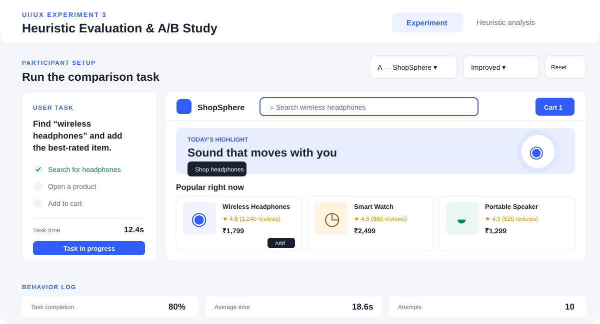
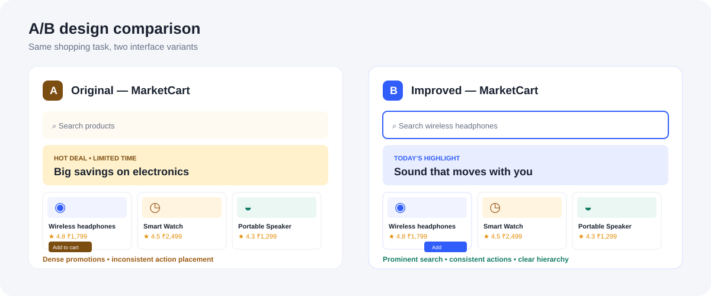

# UI/UX Experiment 3

## Heuristic Evaluation & A/B Testing

This repository contains a complete interactive submission for a heuristic evaluation of two shopping-app interfaces:

- **A — ShopSphere**
- **B — MarketCart**

The experiment includes original and improved variants for both apps, a Nielsen heuristic comparison, timed task measurement, completion tracking, and a printable lab report.

## Preview

### Interactive experiment



### A/B design variants



## Files

- `index.html` — interactive A/B prototype
- `lab-report.html` — complete lab report; use **Print / Save as PDF**
- `lab-report.pdf` — PDF submission file (generate using the print button)
- `styles.css` — application styling
- `script.js` — task logic and experiment metrics

## Run the Prototype

Open `index.html` directly in a browser, or start a local server:

```powershell
python -m http.server 8000
```

Then visit `http://localhost:8000`.

## Participant Task

1. Select App A or B.
2. Select Original or Improved.
3. Press **Start timed task**.
4. Search for “wireless headphones.”
5. Open the Wireless Headphones product.
6. Add the item to the cart.

Metrics are stored in browser local storage. Use **Reset metrics** to clear the current experiment.

## Deliverables

1. GitHub repository URL in the LMS submission text.
2. PDF lab report attached to the submission.
3. Replace the result-template fields in the report with real participant data collected through the prototype.
